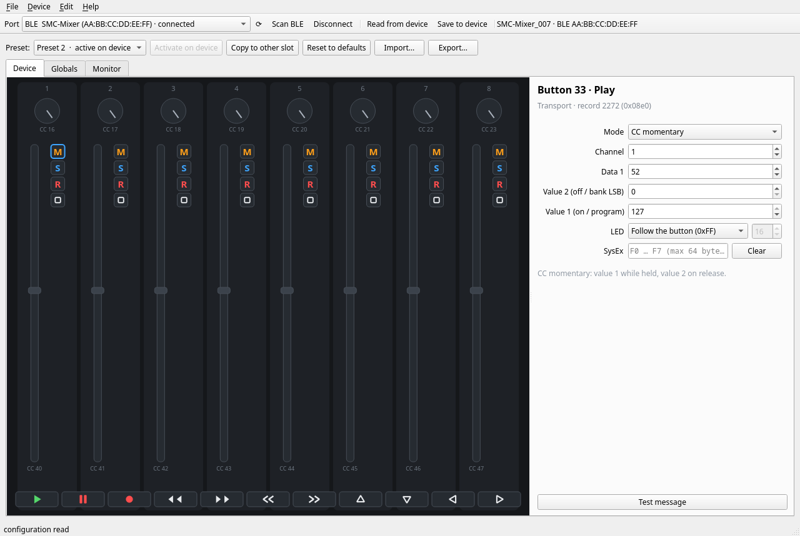
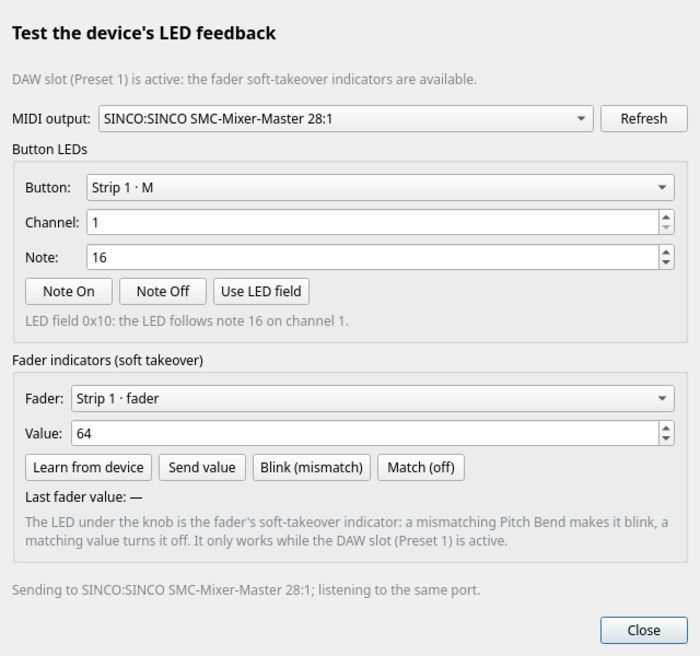

# Midi Suite — SMC-Mixer for Linux

[](https://github.com/Davilka/midisuite-linux/actions/workflows/ci.yml)
[](https://github.com/Davilka/midisuite-linux/releases)
[](LICENSE)

Independent Linux editor for the **M-VAVE / SINCO SMC-Mixer** MIDI controller.
It reads and writes the complete device configuration over USB MIDI: two
presets, 43 buttons, eight encoders and eight faders, with per-control MIDI
modes, SysEx payloads and LED feedback.

The application is a clean-room reimplementation: all code, UI and default
data are original, and no assets or code from the vendor application are
shipped.  See [`docs/CLEAN_ROOM.md`](docs/CLEAN_ROOM.md) and
[`docs/protocol.md`](docs/protocol.md).



## Features

* **Visual device panel** — click any of the 8 strips (knob, fader and the
  four buttons marked **M**, **S**, **R**, **■**) or the 11 transport buttons
  (play, pause, record, rewind, fast-forward, previous, next and the four
  arrows), drawn with their backlight colours.
* **Per-control editor** — message mode, channel, controller/note, values,
  SysEx buffer (up to 64 bytes), LED feedback (local follow or a MIDI note),
  range and response curve.
* **Two presets** — the device's active slot is detected on read and marked in
  the selector; **Activate on device** switches the hardware to the selected
  slot.  Presets can also be copied or reset to a sensible built-in default.
* **USB MIDI and Bluetooth LE** — the configuration protocol is the same on
  both links.  The port list shows USB ports and paired BlueZ devices side by
  side; **Scan BLE** performs a fresh discovery.
* **Read / Save** — the whole 6282-byte user block is read and written in
  chunks; untouched bytes are preserved exactly.
* **Undo / redo** with coalescing (Ctrl+Z / Ctrl+Shift+Z).
* **Import / export** — JSON (full configuration) or raw `.bin` user block.
* **Built-in defaults** generated by the application, not copied from the
  vendor preset.
* **Test message** — sends the selected control’s MIDI to a virtual output
  port (`MidiSuite Test`) so you can check the mapping in a DAW.
* **LED feedback test** — sends Note On/Off to button LEDs and Pitch Bend to
  the fader soft-takeover indicators, with an optional fader-position learn.
* **Globals** hex editor and a live **traffic monitor** (sent and received
  packets).
* **Update checking** through GitHub Releases with a configurable interval
  (hourly / daily / weekly / monthly / never, default daily).  Nothing is
  installed automatically — the dialog links to the release page.
* **CLI** for scripts: dump, restore, raw block access, preset copy.

## Requirements

* Linux with ALSA (PipeWire or JACK via the ALSA sequencer is fine)
* Python 3.10+
* The SMC-Mixer connected over USB (configuration port `…-Private`) or via
  Bluetooth LE (paired with BlueZ)

## Install

The recommended way is the prebuilt bundle from
[**Releases**](https://github.com/Davilka/midisuite-linux/releases) (no Python
required):

```bash
tar xzf midisuite-gui-linux-x86_64-<version>.tar.gz
cd midisuite-gui-linux-x86_64
./midisuite-gui
```

A wheel and a source install are also available:

```bash
git clone https://github.com/Davilka/midisuite-linux.git
cd midisuite-linux
python -m venv .venv && . .venv/bin/activate
pip install -e .
midisuite-gui
```

See [`docs/INSTALL.md`](docs/INSTALL.md) for desktop integration, updates,
uninstall, settings and troubleshooting.

## Run

1. Select `USB  SINCO … SMC-Mixer-Private` (or a `BLE  SMC-Mixer (address)`
   entry) and press **Connect**.
2. Press **Read from device**.
3. Click a control on the panel and edit it on the right.
4. Press **Save to device** to write the configuration back.

The virtual test port appears as **MidiSuite Test** in other applications
after the first **Test message** click.

### Command line

```bash
midisuite ports                 # list MIDI ports
midisuite info                  # device name / firmware
midisuite dump cfg.json         # read the whole configuration
midisuite restore cfg.json      # write it back
midisuite copy-preset 1 2       # copy preset 1 over preset 2
midisuite reset                 # write the built-in default preset
midisuite get 5 0 64            # raw block read (block, offset, length)
midisuite put 5 0 "01 00 14…"   # raw block write
midisuite raw "00 59 23 …"      # one raw packet, print the reply
```

## Building and releases

```bash
scripts/build-bundle.sh            # wheel + sdist + standalone PyInstaller bundle
```

The self-contained archive is written to
`dist/midisuite-gui-linux-x86_64-<version>.tar.gz`.

Pushing a tag `v1.0.0` runs `.github/workflows/release.yml`, which runs the
tests, builds the wheel, the sdist and the standalone bundle and publishes
them to GitHub Releases with a `SHA256SUMS` file.  Release notes are kept in
[`CHANGELOG.md`](CHANGELOG.md).  A release can also be
started manually from the Actions tab.  See [`docs/BUILD.md`](docs/BUILD.md)
for details, local build instructions and troubleshooting.

## Notes on behaviour

* The encoders are continuous (no detents).  In absolute CC mode the value is
  `round(position × max / 127)`; the `curve` byte controls the response speed.
* Faders in absolute CC mode map the travel to `min…max`.
* **Button LEDs** (byte 70 of the button record) have two modes:
  `0xFF` makes the LED follow the button itself (toggle buttons latch,
  momentary buttons light only while held); a value `0…127` makes the LED
  respond to incoming Note On/Off with that note number.  Note feedback works
  in CC presets too — set the LED field to a note number in the inspector.
* **The eight LEDs under the knobs** are fader soft-takeover indicators, not
  knob LEDs.  They respond to Pitch Bend on the fader's channel: a value
  different from the physical fader makes the LED blink, a matching value
  turns it off.  They only work while the DAW slot (Preset 1) is active.
  To keep custom CC mappings and the indicators, copy the CC preset into
  slot 1 (this replaces the factory DAW preset; keep a backup).  The
  **Device → Test LED feedback…** dialog sends both kinds of messages.
* SysEx modes send the buffer as raw bytes: include `F0`/`F7` yourself.



The test dialog needs a normal MIDI output port: the USB
`…SMC-Mixer-Master` port, or an ALSA BLE-MIDI port if your Bluetooth stack
exposes one.  The configuration connection (USB `…-Private` or the BLE
config service) is separate.

The full measured protocol (packets, checksum, base-128 packing, memory map,
message modes, LED behaviour) is documented in
[`docs/protocol.md`](docs/protocol.md).

## Limitations

* Only the SMC-Mixer is supported.  The protocol layer is device independent
  and other models of the same family can be added with their own memory map.
* Firmware/application updates from the vendor are not implemented.
* The meaning of most bytes in the 128-byte global block is undocumented; the
  editor exposes them as raw hex.


## Contributing

Issues and pull requests are welcome.  See [`CONTRIBUTING.md`](CONTRIBUTING.md)
for the development setup and the hardware-testing rules.  Please keep the
project independent: do not paste vendor code, firmware images or assets.

## License

MIT.  Third-party components and their licenses are listed in
[`THIRD_PARTY_NOTICES.md`](THIRD_PARTY_NOTICES.md).  M-VAVE, CUVAVE, SINCO and
SMC-Mixer are trademarks of their respective owners; this project is not
affiliated with them.

---

## Кратко по-русски

Независимый редактор SMC-Mixer для Linux (Python + PySide6).  Установка:
`python -m venv .venv && . .venv/bin/activate && pip install -e .`, запуск —
`midisuite-gui`.  Подключите устройство по USB, выберите порт
`USB  SINCO … SMC-Mixer-Private` или `BLE  SMC-Mixer`, нажмите **Connect** →
**Read from device**.
Редактирование — кликом по контролу на панели; **Save to device** записывает
конфигурацию.  Протокол и раскладка памяти описаны в `docs/protocol.md`.
